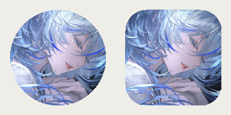

# 彩色人物图标

三端使用用户提供的蓝色人物插画。保留原始画面和颜色，按平台规格居中裁切及缩放，不做 AI 重绘。原图保存在 [Avatar.png](Avatar.png)。

- Android：432 × 432 彩色自适应前景，圆形及圆角由启动器裁切。照片类图标不设置单色主题蒙版，避免整块变成纯色。
- iOS：1024 × 1024 不透明正方形，由系统添加圆角。
- macOS：1024 × 1024，保留 Dock 图标的透明边距和圆角。

Windows 在仓库根目录运行 `./docs/artwork/render-icon.ps1`；macOS 运行 `swift docs/artwork/render-icon.swift`。两份脚本都只生成平台资源尺寸，不修改原图。

